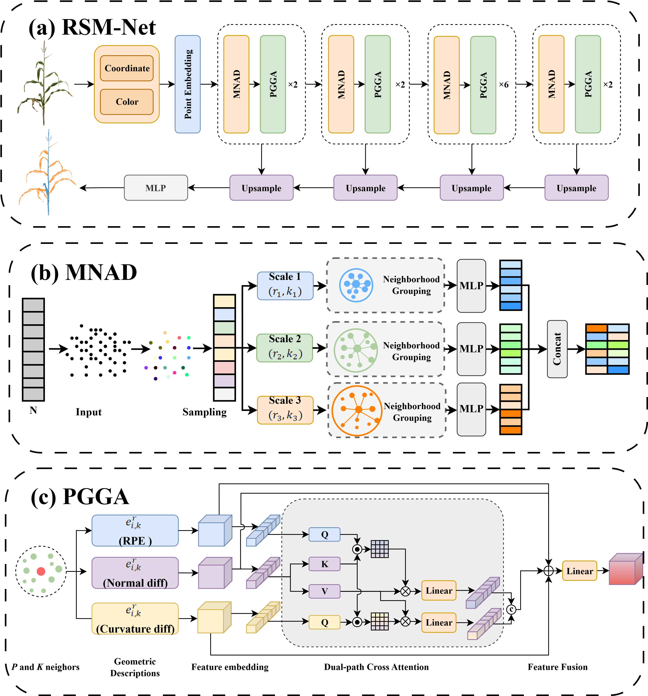

# A geometry-aware framework for 3D point cloud segmentation and leaf area estimation across multiple maize growth stages
Ruihang Li†, Zhiao Wang†, Haochun Li, Jiawei Shen, Xiaoyan Zhao, Guomin Zhou*, Jianhua Zhang*

<div align="center">
  
</div>

# Highlight

RSM-Net for 3D Point Cloud Semantic Segmentation. We develop a geometry-aware semantic segmentation network that integrates Position Geometric Attention (PGGA) and Multi-scale Neighborhood Aggregation Downsampling (MNAD) to enhance geometric feature representation and multi-scale feature aggregation for accurate maize stem and leaf segmentation.

Geometry-Constrained Supervoxel Graph Clustering (GC-SGC) for Leaf Instance Segmentation. We develop a supervoxel graph clustering algorithm that incorporates geometric constraints to distinguish adjacent and overlapping maize leaves and improve leaf instance segmentation.

Adaptive Plane Filtering (APF) for Point Cloud Denoising. We develop an adaptive plane filtering algorithm based on local plane fitting and adaptive residual thresholds to remove ghost points and improve point cloud quality for subsequent leaf area estimation.

# Code Structure
```
RSM-Net/: Semantic segmentation network.

GC-SGC.py: Supervoxel graph clustering algorithm for leaf instance segmentation.

APF.py: Adaptive plane filtering algorithm for point cloud denoising.
```

# Get Started

## RSM-Net Environment

1. Install dependencies

```
pip install -r requirements.txt
```

If you have any problem with the above command, you can also install them by

```
pip install torch_sparse==0.6.12
pip install torch_points3d==1.3.0
pip install tensorboard timm termcolor tensorboardX
```

2. Compile pointops

Make sure you have installed `gcc` and `cuda`, and `nvcc` can work (Note that if you install cuda by conda, it won't provide nvcc and you should install cuda manually.). Then, compile and install pointops2 as follows. (We have tested on gcc==7.5.0 and cuda==10.1)
```
cd lib/pointops2
python3 setup.py install
```

## Datasets Preparation

Please refer to https://github.com/yanx27/Pointnet_Pointnet2_pytorch for S3DIS preprocessing. Then modify the `data_root` entry in the .yaml configuration file.


## Training

```
python3 train.py --config config/s3dis/s3dis_rsm_transformer.yaml
```

## Testing
For testing, first change the `model_path`, `save_folder` and `data_root_val` (if applicable) accordingly. Then, run the following command. 
```
python3 test.py --config config/s3dis/s3dis_rsm_transformer.yaml
```

## Pre-trained Models

For your convenience, you can download the pre-trained models from [here](https://drive.google.com/file/d/1sOgrg9w48iiYe03udaG7KRgl3mOob3zL/view).

## Data availability
Evaluation data is available at [here](https://drive.google.com/file/d/15se9HzdY3IPCrI789J58LUbipYaxDWaj/view)
The complete dataset is available from the corresponding author upon request.

# Citation
Waiting publish
